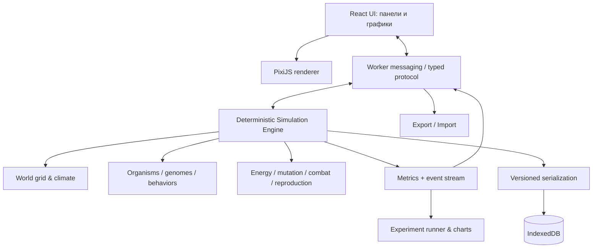

Here is the result of "fetch" for the Page with URL https://app.notion.com/p/41f9fe7da94081a5a390e15178397ce8 as of 2026-11-21T18:28:05.851Z:
<page url="https://app.notion.com/p/41f9fe7da94081a5a390e15178397ce8" icon="🧬">
<ancestor-path></ancestor-path>
<properties>
{"title":"Digital Darwin — Project Bible / архитектура и стратегия"}
</properties>
<iconMetadata>{"type":"emoji","emoji":"🧬"}</iconMetadata>
<content>
> <b>Статус:</b> архитектурный проект / RFC 0.1, реализация ещё не начата. <b>Дата:</b> 21.11.2026. <b>Исполнитель:</b> Codex как автономный разработчик; пользователь - заказчик и наблюдатель. <b>Назначение:</b> самостоятельный pet-project для развлечения, экспериментирования и изучения возникающего поведения; НЕ часть учебного трека Data Engineering.

# DIGITAL DARWIN — Project Bible

<callout icon="🧬" color="green_bg">
<b>Одна фраза:</b> наблюдаемая интерактивная цифровая экосистема, в которой организмы наследуют изменяемые свойства, конкурируют за ограниченные ресурсы, выживают, размножаются и иногда формируют неожиданные стратегии поведения без сценарного управления каждым событием.
</callout>

<table-of-contents />

## Навигатор спецификаций

- <mention url="https://app.notion.com/p/41f9fe7da94081a3a9baea296845a573">01 — Экология, геном и законы эволюции</mention> — мир, ресурсы, энергетика, организмы, мутации, инварианты.
- <mention url="https://app.notion.com/p/41f9fe7da94081e8afd7e79c60d3ace3">02 — Движок, модули, API и масштабирование</mention> — кодовая архитектура, tick pipeline, worker, deterministic RNG, производительность.
- <mention url="https://app.notion.com/p/41f9fe7da94081829027ea839fdf81ca">03 — UX, интерфейс и интерактивный мир</mention> — пользовательские сценарии, экран, карта, инспектор, визуализация.
- <mention url="https://app.notion.com/p/41f9fe7da94081908cffd395fdb42dce">04 — Эксперименты, аналитика и научная проверка</mention> — гипотезы, контрольные группы, статистика, интерпретация.
- <mention url="https://app.notion.com/p/41f9fe7da94081168e62f8224afc98a2">05 — Сохранения, форматы, replay и данные</mention> — манифесты, версии, миграции, снапшоты, история.
- <mention url="https://app.notion.com/p/41f9fe7da9408144abf8f2054f9e9602">06 — Roadmap, Codex AGENTS.md и контроль качества</mention> — этапы, готовый стартовый промпт, Definition of Done, CI.
- <mention url="https://app.notion.com/p/41f9fe7da94081a08085e3b982b0477c">07 — Очередь промптов Codex и проверка результатов</mention> — 13 последовательных запросов DD-00…DD-12, приёмочные тесты, отчёты и исправляющие промпты.

<callout icon="🚀" color="blue_bg">
<b>Старт разработки:</b> сначала прочитать страницу 06 и выдать Codex самый первый промпт из раздела 6. Сама эта документация не создаёт репозиторий и не подключает Codex к Notion; перед запуском передать спецификации ему в файлах репозитория.
</callout>

## 1. Продуктовое видение

Пользователь нажимает «Создать мир», выбирает seed/пресет и видит живой двумерный мир. Организмы ищут энергию, избегают опасностей, воспроизводятся и гибнут; цветовые популяции меняются, возникают линии потомков, экологические кризисы, временное доминирование разных стратегий. Можно ускорять время, исследовать любого организма, смотреть генеалогию, графики, экспериментировать с условиями, сохранять мир и пересматривать исторические моменты.

<b>Принцип:</b> симуляция должна отвечать на «почему это произошло?» данными о состоянии системы, а не случайными литературными объяснениями. Система не должна обещать неизбежное возникновение интеллекта, коллективизма, новых видов или жизни из ничего.

## 2. Ценность

- <b>Созерцание:</b> запуск автономного мира и наблюдение за долгосрочными изменениями без микроменеджмента.
- <b>Эксперимент:</b> изменение параметров среды, мутации, доступности пищи, хищничества, климата; сравнение разных сценариев.
- <b>Исследование:</b> хронология эволюционных событий, семейные деревья, распределения признаков, данные о причинах вымирания.
- <b>Повторяемость:</b> один и тот же seed + конфигурация + версия движка дают воспроизводимую последовательность состояний в поддерживаемой среде.
- <b>Творчество:</b> красивые карты, живые траектории и неожиданные, но объяснимые визуально изменения популяций.

<b>Главный критерий:</b> симулятор сам по себе интересен спустя 10–30 минут наблюдения, а не только в первую минуту после запуска.

## 3. Принятые архитектурные решения (рекомендация к реализации)

| Решение | Базовый выбор | Почему |
| --- | --- | --- |
| Режим | Local-first браузерное приложение, без аккаунтов и сервера | Автономность, бесплатный запуск, приватность |
| Язык ядра | TypeScript, независимый от React/DOM | Быстрый старт Codex, общие типы с UI, тестируемость |
| UI | React + TypeScript + Vite | Небольшой dev-контур, богатая экосистема |
| Отрисовка | PixiJS (WebGL-путь по умолчанию) | Много динамических объектов и масштабирование сцены |
| Потоки | Sim Worker отдельно от UI | Движок не блокирует интерфейс |
| Данные мира | TypedArrays + Entity IDs + пространственный индекс | Избегаем тысячи тяжёлых объектов и полного перебора соседей |
| Хранение | IndexedDB через адаптер, ZIP export/import | Локальность, переносимость |
| Тесты | Vitest + property-based + Playwright smoke | Верифицируем поведение и интерфейс |
| Монорепозиторий | pnpm workspace, несколько packages | Лёгкая модульность без микросервисов |
| Оптимизация v2 | WASM/Rust только после профилирования | Не усложнять раньше времени |

Это <b>проектные предложения</b>, не уже созданный код. Внешние ограничения и версии зависимостей Codex должен проверить в момент реализации.

## 4. Что входит и не входит в проект

<b>Входит в MVP:</b> карта и пищевые ресурсы; 1000–5000 простых организмов; базовый геном/мутации; поиск пищи, движение, метаболизм, размножение и смерть; визуализация; пауза/скорость; инспектор существа; 3–5 графиков; seed; сохранение; сценарии и автотесты.

<b>Расширения по этапам:</b> хищники, защита, сезоны, память, сигналы, кооперация, более сложные контроллеры, генетические кластеры, разветвлённые родословные, экспериментальный стенд, офлайн-симуляция, галерея миров.

<b>Не входит изначально:</b> полноценный молекулярный биохимический симулятор; научно доказанная модель эволюции реальных организмов; генеративный AI как «мозг» каждого агента; криптокошельки/NFT; сетевой MMO; обязательная облачная инфраструктура; мобильное приложение; обещание разумной жизни.

## 5. Опыт пользователя: три сценария

<b>A. Наблюдатель.</b> Выбрать «Сбалансированный мир», нажать Play и 20 минут наблюдать. Увидеть изменения численности, вымирания отдельных линий, интересные события. Открыть историю и увеличить скорость до 32×.

<b>B. Экспериментатор.</b> Запустить две копии одного seed с одинаковыми параметрами, но разной доступностью ресурсов. Получить сравнительные графики и распределение геномных признаков. Изменение параметров во время живого запуска создаёт пометку «интервенция» и разрывает чистую базу сравнения.

<b>C. Архивариус.</b> Сохранить мир после 50 000 тиков, открыть его через месяц, просмотреть выбранный момент и предков доминирующей линии, экспортировать файл мира.

## 6. Карта продукта

1. <b>Основная сцена:</b> мир с панорамированием/зумом, цветами по генетическому признаку, режимами тепловой карты ресурсов и плотности популяций.
2. <b>Панель симуляции:</b> пауза, 1×/4×/16×/32×, одиночный тик, TPS и число организмов.
3. <b>Инспектор агента:</b> энергия, возраст, геном, поведение, родители, потомки, обстоятельства смерти.
4. <b>Эволюционная аналитика:</b> популяция, рождаемость/смертность, ресурсы, средние признаки, разнообразие, распределения.
5. <b>Лента событий:</b> массовая гибель, локальный кризис, появление новой линии, резкое изменение признаков, изменение условий.
6. <b>Лаборатория:</b> пресеты экспериментов, контрольные группы, параметры, сравнения нескольких запусков.
7. <b>Архив:</b> слоты сохранения, экспорт/импорт, история, версии формата.

## 7. Нефункциональные требования

- <b>Без платных внешних API;</b> работа после первой установки без интернета.
- <b>Чёткий бюджет производительности;</b> целевой профиль MVP: 256×256 ячеек, 5000 организмов, стремиться к 30 симуляционным тикам/с на типовом современном настольном ПК. Число является <b>целевым ориентиром</b>, не обещанием: подтвердить измерениями.
- <b>Плавный UI</b> даже при ускоренном расчёте; частота рендеринга отделена от скорости симуляции.
- <b>Устойчивость:</b> длинный прогон 100 000 тиков без аварии, NaN, отрицательных ресурсов и утечки неограниченного объёма памяти в установленном тестовом окружении.
- <b>Надёжное сохранение:</b> отказоустойчивый формат и явная проверка версий; ошибки читаемы.
- <b>Наблюдаемость:</b> счётчики TPS, время фаз tick, память, число взаимодействий, длина очередей, dropped frames.
- <b>Доступность:</b> клавиатурное управление панелями, понятные цвета/подписи, минимум зависимости от цвета как единственного кодирования.
- <b>Сложность:</b> новые поведения и ресурсы добавляются через версионированные интерфейсы/регистры, а не рефакторинг всего приложения.

## 8. Критерии успеха (проверяемые)

| ID | Критерий | Проверка |
| --- | --- | --- |
| S1 | Мир живёт без ручного управления минимум 100 000 тиков | Headless longevity test |
| S2 | Разные seed дают различающиеся траектории, а одинаковый seed воспроизводим | Golden determinism tests |
| S3 | Наследуемые признаки меняются между поколениями; можно объяснить влияние отбора | Серии seeded runs и контроль без мутаций/без селекции |
| S4 | Экосистема не сводится к декоративному random walk | Food gradient / mortality / fitness experiments |
| S5 | Можно открыть, остановить, ускорить и сохранить мир без просмотра кода | E2E тест UI |
| S6 | При естественном изменении численности нет систематического создания энергии «из воздуха» кроме объявленных источников | Invariant & budget accounting |
| S7 | После новой механики старые сценарии продолжают запускаться | Contract tests + snapshot migrations |
| S8 | Агент Codex способен выполнять задачи по контракту автономно | PR checklist, CI, smoke + acceptance report |

## 9. Архитектура на одной схеме

<b>Граница системы:</b> UI никогда напрямую не изменяет массивы мира; команды направляются через протокол, исполняются на границе tick, сохраняются в журнале вмешательств. Движок ничего не знает о Canvas, React и IndexedDB.

## 10. План документации

Ниже располагаются самостоятельные спецификации (архитектура движка, биологическая модель, интерфейс, данные/эксперименты, план Codex). Каждая содержит интерфейсы, компромиссы, критерии приёмки и ограничения. Эта страница - источник продуктовых требований, дочерние - источник инженерных требований.

## 11. Реестр рисков

| Риск | Вероятность / влияние | Предотвращение |
| --- | --- | --- |
| Мир быстро умирает | Высокая / высокое | Балансировка ресурсов, стартовые пресеты, longevity tests |
| Возникает только хаос вместо эволюции | Высокая / высокое | Понятная модель наследования и измерения отбора |
| Ложная «научность» | Средняя / высокое | Разделять моделируемое и наблюдаемое; контрэксперименты |
| 5–50 тыс. агентов тормозят | Средняя / высокое | SoA, spatial hashing, batches, профилирование |
| Изменения ломают старые сохранения | Средняя / высокое | Версии схем и миграции + тесты |
| Codex пишет огромный неработающий проект | Высокая / высокое | Малые вертикальные срезы, проверяемые acceptance criteria |
| Случайные патчи ломают детерминизм | Средняя / высокое | Seeded RNG, стабильный порядок событий, golden tests |
| Бесконечный scope creep | Высокая / среднее | Ворота релизов, строгий MVP и backlog после него |

## 12. Первые инструкции Codex

<b>Первое автономное задание:</b> создать только foundation + работающий вертикальный срез: генерация карты, простой ресурс, организмы с движением/энергией/смертью/размножением, PixiJS-сцена, управление скоростью, график популяции, seed, три теста инвариантов и запуск одной командой. Не создавать декоративные заглушки для будущих систем.

После первого запуска Codex должен сохранить <code>ARCHITECTURE.md</code>, <code>AGENTS.md</code>, <code>DECISIONS.md</code>, <code>README.md</code>, результаты тестирования и перечень реальных отклонений от этого RFC. Вся функциональность сопровождается тестами.

## 13. Источники и статус

Технические справочники: [PixiJS renderers](https://pixijs.com/guides/components/renderers/), [MDN OffscreenCanvas](https://developer.mozilla.org/en-US/docs/Web/API/OffscreenCanvas), [Mesa ABM framework](https://mesa.readthedocs.io/stable/index.html), [SQLite WAL](https://www.sqlite.org/wal.html) - SQLite рассматривается только как альтернативный серверный или desktop-адаптер, не как основной браузерный storage.

<b>Обозначения:</b> «зафиксировано» - требование этого проектного документа; «предложено» - техническое решение, которое Codex может изменить только с документированным rationale; «будущее» - не входит в MVP. Статус всего проекта: <b>спроектировано, не реализовано</b>.

<page url="https://app.notion.com/p/41f9fe7da94081a3a9baea296845a573">
01 — Экология, геном и законы эволюции
</page>

<page url="https://app.notion.com/p/41f9fe7da94081e8afd7e79c60d3ace3">
02 — Движок, модули, API и масштабирование
</page>

<page url="https://app.notion.com/p/41f9fe7da94081829027ea839fdf81ca">
03 — UX, интерфейс и интерактивный мир
</page>

<page url="https://app.notion.com/p/41f9fe7da94081908cffd395fdb42dce">
04 — Эксперименты, аналитика и научная проверка
</page>

<page url="https://app.notion.com/p/41f9fe7da94081168e62f8224afc98a2">
05 — Сохранения, форматы, replay и данные
</page>

<page url="https://app.notion.com/p/41f9fe7da9408144abf8f2054f9e9602">
06 — Roadmap, Codex [AGENTS.md](http://AGENTS.md) и контроль качества
</page>

<page url="https://app.notion.com/p/41f9fe7da94081a08085e3b982b0477c">
07 — Очередь промптов Codex и проверка результатов
</page>
</content>
</page>
