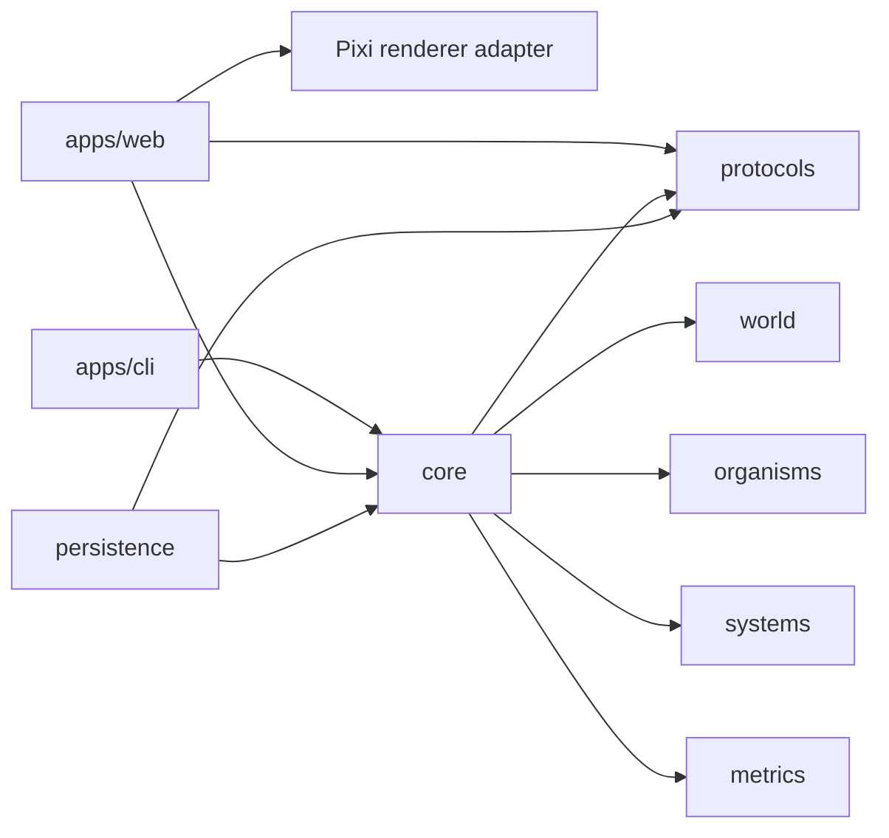

Here is the result of "fetch" for the Page with URL https://app.notion.com/p/41f9fe7da94081e8afd7e79c60d3ace3 as of 2026-11-21T18:19:14.874Z:
<page url="https://app.notion.com/p/41f9fe7da94081e8afd7e79c60d3ace3" icon="⚙️">
<ancestor-path></ancestor-path>
<properties>
{"title":"02 — Движок, модули, API и масштабирование"}
</properties>
<iconMetadata>{"type":"emoji","emoji":"⚙️"}</iconMetadata>
<content>
<b>Принцип:</b> сначала простой детерминированный headless engine, затем UI; никакой бизнес-логики биологии в компонентах React. Готовность к 50 000+ агентов достигается <i>измерениями и заменяемыми адаптерами</i>, а не микро-сервисами на старте.

## 1. Технический стек и решения

- <b>TypeScript strict</b>, Vite, React, PixiJS, Vitest, Playwright, pnpm workspaces. Движок должен работать и в Node/headless, и в браузерном Worker без <code>window</code>, <code>document</code>, <code>Date.now</code>, сетевых запросов.
- UI-state (настройки окон/панелей) отдельно от simulation-state; библиотека state management необязательна, допускается Zustand.
- IndexedDB как постоянный storage через интерфейс <code>PersistencePort</code>, реализация допускает Dexie. Сохранение логически не зависит от DB.
- Графики: лёгкий charting в UI (выбор после проверки bundle/perf). Аналитика работает по агрегатам, не копирует весь world state в React.
- В перспективе - Rust/WASM-модуль для одной или нескольких горячих фаз через ABI; <b>не вводить до измеренного bottleneck</b>.
- Все значимые зависимости зафиксировать через lockfile и ADR с версией/основанием. Исследовательские ориентиры: [PixiJS docs](https://pixijs.com/guides/components/renderers/) и [OffscreenCanvas](https://developer.mozilla.org/en-US/docs/Web/API/OffscreenCanvas).

## 2. Структура монорепозитория

```txt
digital-darwin/
  apps/
    web/                  # React UI, Pixi bridge, worker bootstrap
    cli/                  # headless batches, benchmarks, scenarios
  packages/
    core/                 # pure deterministic tick engine, ports
    world/                # terrain, fields, resource generation
    organisms/            # genomes, phenotypes, lifecycles, controllers
    systems/              # movement, food, reproduction, decay, ecology
    protocols/            # command/event types, schema validation
    metrics/              # aggregates, experiment measures
    persistence/          # snapshot codecs, IndexedDB adapters
    scenarios/            # config, presets, seeds, interventions
    test-kit/             # fixtures, invariant assertions, seeded runs
  docs/
    architecture/
    adr/
    experiments/
  scripts/
  .github/workflows/
  AGENTS.md
  ARCHITECTURE.md
  CONTRIBUTING.md
  README.md
  package.json
  pnpm-workspace.yaml
```

Физическое разбиение на packages может быть сокращено в v0.1, но границы модулей/импортов должны соответствовать. Лучше 4 хорошо разделённых пакета, чем 12 пустых.

## 3. Зависимости модулей



Обратных зависимостей запрещено: <code>core</code> не импортирует UI, renderer, IndexedDB, React; <code>world</code> не импортирует React; <code>organisms</code> не знает о слоях отображения. Код событий и snapshot transport в версии с чёткими схемами.

## 4. Ключевые контракты TypeScript (псевдо-API)

```ts
export type Tick = number;
export type EntityId = number;
export type Seed = string;
export interface SimulationConfig {
  schemaVersion: number;
  world: { width: number; height: number; topology: "torus" | "bounded" };
  initialPopulation: number;
  rngSeed: Seed;
  scenarioId: string;
  modules: string[];
  parameters: Record<string, number | boolean | string>;
}
export interface SimulationEngine {
  initialize(config: SimulationConfig): void;
  step(ticks: number): StepReport;
  command(command: SimCommand): CommandReceipt;
  snapshot(): SimulationSnapshot;
  restore(snapshot: SimulationSnapshot): void;
  getObservation(view: ObservationQuery): ObservationDTO;
}
export interface SimulationSystem {
  id: string;
  version: string;
  phase: TickPhase;
  dependsOn: string[];
  execute(context: MutableTickContext): void;
}
export interface RandomStream {
  nextUint32(): number;
  nextFloat01(): number;
  fork(label: string): RandomStream;
  serialize(): Uint32Array;
}
```

<code>Record<string,...></code> здесь - внешнее конфигурационное расширение; в движке конкретные системы читают <b>типизированные валидированные config schemas</b>, не произвольные строки. <code>MutableTickContext</code> закрыт внутри engine; внешние расширения получают ограниченный capability API.

## 5. Tick scheduler / стадии

```txt
[0] Apply versioned user commands at tick boundary
[1] Environment: light / producers / nutrient diffusion
[2] Spatial index rebuild or incremental update
[3] Snapshot perceptions: read-only world at tick-start
[4] Decide: one Intent per living entity
[5] Resolve movement & boundaries (no double actions)
[6] Resolve interactions & resource claims (fixed tie-break)
[7] Metabolism, damage, death accounting
[8] Reproduction, mutation, newborn insertion
[9] Detritus/recycling (if configured at this stage)
[10] Finalize events, metrics, invariants, hash, checkpoints
```

<b>Правила:</b> каждая система регистрируется в фиксированной фазе и может только через разрешённые API мутировать состояние; зависимости систем оформляются DAG с валидацией циклов; порядок одинаков при каждом запуске. Никаких мутаций read-only snapshot во время decide. Важно определить, когда именно newborn становится доступным для индексирования и действий.

## 6. Детерминизм

- Псевдослучайный генератор: конкретный алгоритм <code>PCG32</code> или <code>xoshiro128**</code>; выбранный алгоритм, версия и seed входят в snapshot/manifest.
- Не использовать <code>Math.random()</code> в core; каждый subsystem получает <code>fork("system-id")</code>; для независимости от числа агентов при изменении алгоритма желательно RNG на основе <code>seed+tick+entityId+purpose</code> (counter/hash-based) для локальных решений.
- Порядок IDs, обработка конфликтов и сериализация стабильны. Результаты не зависят от FPS и wall-clock.
- В MVP гарантировать byte-identical повтор в одинаковых версиях движка и одинаковой runtime-матрице; кросс-браузерную битовую идентичность заявлять только после тестов или перевода критических операций в фиксированную арифметику.
- Рекомендуется fixed-point для ресурсов/энергии; координаты можно хранить в fixed-point или float32 с явным правилом округления.
- Все runtime вмешательства пишутся в командный журнал с <code>tick, commandId, schemaVersion</code>.
- Версия движка и config hash - часть всех reproducibility artefacts; сравнивать миры разных версий как одинаковые нельзя без оговорки.

## 7. Модель данных в памяти

<b>Мир:</b> структура массивов по полям (SoA), например <code>Float32Array</code> или фиксированное integer representation для биомассы, питательных веществ, света и температуры. Индекс клетки <code>i = y*width+x</code>. Поля ресурса могут обновляться batched/chunked.

<b>Организмы:</b> SoA storage: <code>id:Int32Array</code>, <code>x:Float32Array</code>, <code>energy:Int32Array</code>, <code>genome:</code> отдельный непрерывный буфер длиной <code>N*geneCount</code>, <code>alive:Uint8Array</code>, и т.п. Гетерогенные редкие сведения (genealogy, deathCause) вынести в отдельные структуры.

- <code>EntityId</code> стабильный на весь прогон, не равен <code>slotIndex</code> и <b>никогда не переиспользуется</b>; свободные слоты можно переиспользовать через freelist и версионированные handles.
- Хранить внешние ID для инспектора, истории и графов, независимо от компактирования массивов.
- Spatial hash по клеткам/чанкам, ограниченный радиус запросов и neighbour caps. Строить профилирование плотных кластеров.

## 8. Worker и протокол обмена

UI отправляет <b>команды</b>, не мутирует engine напрямую:

```ts
type SimCommand =
  | { kind: "start"; requestId: string }
  | { kind: "pause"; requestId: string }
  | { kind: "step"; ticks: number; requestId: string }
  | { kind: "setSpeed"; multiplier: number; requestId: string }
  | { kind: "intervene"; atTick: number; intervention: InterventionDTO; requestId: string }
  | { kind: "inspect"; entityId: number; requestId: string }
  | { kind: "snapshot"; requestId: string };

type WorkerEvent =
  | { kind: "ack"; requestId: string; appliedAtTick: number }
  | { kind: "frame"; seq: number; tick: number; positions: ArrayBuffer; colors: ArrayBuffer }
  | { kind: "stats"; tick: number; samples: MetricsDTO }
  | { kind: "error"; category: string; message: string; recoverable: boolean };
```

- Versioned protocol <code>protocolVersion</code>; schema validation at UI/worker boundary.
- Position/color batches передавать <code>Transferable ArrayBuffer</code> или SharedArrayBuffer только после проверки security-isolation условий; не <code>JSON.stringify</code> на каждого агента на каждый кадр.
- Worker организует backpressure: при отставании UI отправлять последнюю доступную визуализацию, <b>не пропускать симуляционные тики</b>. Visualization fps и simulation tps раздельны.
- Для <code>inspect</code> передавать только выбранного агента/небольшой набор.
- <code>requestId</code> коррелирует response, отмена долгой задачи через Abort/Command, каждая команда идемпотентна по requestId при повторной доставке.
- Рендер не должен блокировать решение очередного тика; использовать time budgeting.

## 9. Регистрация систем и расширяемость

```ts
interface ModuleManifest {
  id: string;
  version: string;
  requires: string[];
  addsComponents: string[];
  addsEvents: string[];
  configSchemaVersion: number;
  register(registry: SystemRegistry): void;
}
```

<b>Пример:</b> <code>predator-prey</code> добавляет AttackIntent, защитный ген и систему food-chain, но не меняет существующий код user controls. <code>climate-seasons</code> добавляет temperature field + climate update + fitness modifier. <code>social-signals</code> добавляет сигнал на клетку и новое сенсорное наблюдение.

В MVP <b>статический реестр модулей из исходников</b>, не произвольный runtime execution стороннего кода. Любое расширение: contract tests, seed tests, performance profile, новые schema migrations.

## 10. Масштабирование и бюджет производительности

<b>Базовый ориентир:</b> 256² клеток, 5000 агентов, 30 TPS при измеряемой конфигурации; UI 50–60 fps при разумных условиях. Проверить 1k, 5k, 10k, 25k, 50k и карту 512², записать среднее/p95/память.

Порядок оптимизации:

1. Профилировщик фиксирует процент времени фаз и memory allocations/tick.
2. Избавиться от пер-агентных объектов и повторных heap allocations.
3. Ограничить соседские запросы spatial buckets; не обходить всю карту для каждого агента.
4. Снизить частоту дорогих метрик (например, генетическая кластеризация раз в 100–1000 тиков), а не терять тики.
5. Dirty-cell updates, batching, typed transfer и LOD рендеринга.
6. Chunked world, deterministic parallelism только после формального partitioning протокола; multiprocessing меняет порядок разрешения конфликтов.
7. Для узких мест - рассмотреть WASM/Rust с единым набором golden tests.
8. GPU compute - последняя опция и только с отдельной проверкой воспроизводимости и fallback.

<b>ЗАПРЕЩЕНО:</b> переписывать архитектуру на Rust/микросервисы «потому что масштабируемость» без измеренного выигрыша и контракта.

## 11. Ошибки, диагностика, безопасность

- Ошибка отдельной системы: остановка с отчётом (tick, systemId, seed, engineVersion, state hash), а не тихое продолжение с повреждённым миром.
- Worker crash: UI показывает восстановление последнего валидного snapshot и возможность экспорта diagnostic bundle.
- Бюджет истории, событий и метрик; кольцевой буфер для hot state, исторический store с ограниченной частотой записи.
- Импорт непроверенных файлов: ограничения размера и типов, валидация версий/checksum, никаких eval/динамического выполнения кода, защита от zip bomb.
- Архитектура local-first: никаких секретов/аккаунтов/телеметрии наружу без явного opt-in.
- Ожидается Chromium Windows как основная тестовая платформа, другие браузеры проверяются E2E; рендер fallback документируется.
- Репозиторий: ESLint, TypeScript strict, форматтер, зависимые пакеты с понятными import boundaries, CI: lint/typecheck/unit/integration/e2e/benchmark smoke.

## 12. Архитектурные решения, которые Codex обязан оформить как ADR

ADR-001: pure TypeScript engine vs Rust/WASM. ADR-002: RNG and deterministic scheduling. ADR-003: fixed-point resource semantics. ADR-004: organism storage and entity identity. ADR-005: save/replay versioning. ADR-006: protocol and worker backpressure. ADR-007: metrics sampling and retention. Каждая запись: Context, Decision, Alternatives, Consequences, Evidence, Date.
</content>
</page>
